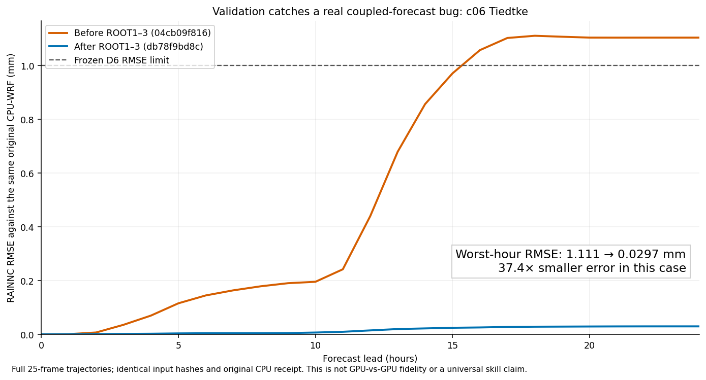
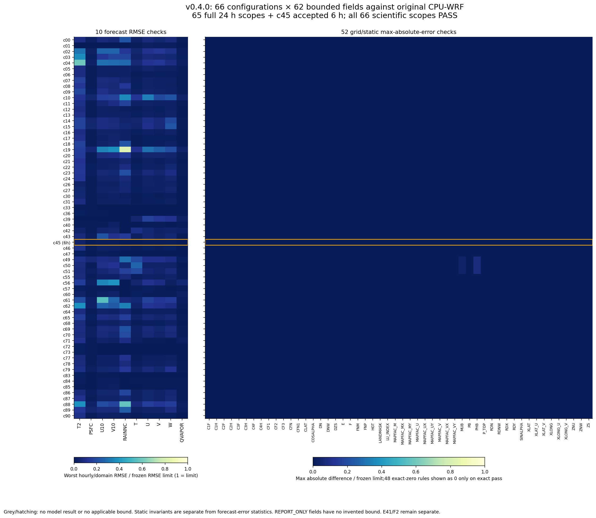
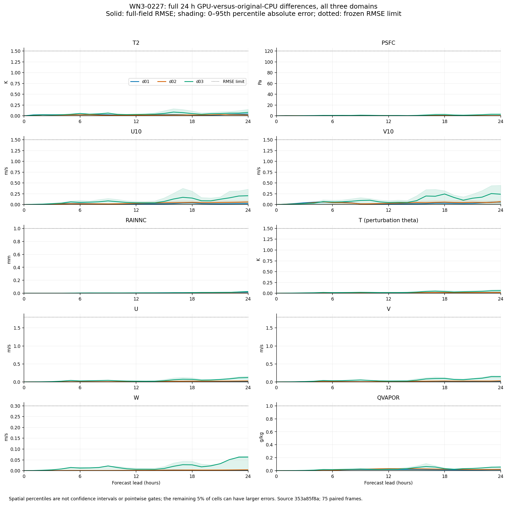

# wrf_gpu

[User guide](https://wrf-gpu.github.io/wrf_gpu/) · [v0.4.0 quickstart](docs/release/USER_GUIDE_v0.4.0.md) · [Supported configurations](docs/release/SUPPORT_MATRIX_v0.4.0.md)

**WRF-compatible regional forecasts on NVIDIA Ampere or newer GPUs.**

`wrf_gpu` implements WRF v4 ARW dynamics and physics with JAX/XLA/Pallas. It
reads prepared WRF inputs, advances the forecast on the GPU, and writes WRF
NetCDF history and authenticated restart state. Existing WPS/real preparation,
namelists and downstream analysis remain useful.

**v0.4.0 release candidate:** default programs are frozen as Swiss
`3356e249` and PROD d01 `196aed9f`. **All 66 registered configurations pass
their accepted scientific scope**: 65 full 24-hour cases plus Goddard radiation
c45's accepted six-hour case. The [source-bound ledger](docs/release/FINAL_COMPOSITES_v0.4.0.md)
records every option tuple, clock and raw result. E41 resource failures,
c89's native-scan uncertainty and F2 limits stay disclosed. Publication
follows final review and the release chain.

The project is independent of UCAR/NCAR. WRF option support and forecast
qualification belong to the exact configurations in the support matrix.

## Install and run a forecast

The Pallas/Triton fast path requires **NVIDIA Ampere or newer, compute
capability 8.0 or higher**. Pascal and Turing are unsupported. A supported
architecture still needs enough GPU and host memory for the chosen grid,
physics and cold compilation. The release evidence uses an RTX 5090;
[hardware scope](proofs/r_docs040/GPU_REQUIREMENTS.json) is explicit.

Use Python 3.11+ and a compatible CUDA 13 driver for the tested CUDA JAX setup.
Install the GPU backend explicitly, then the package:

```bash
git clone https://github.com/wrf-gpu/wrf_gpu.git
cd wrf_gpu
python -m pip install "jax[cuda13]==0.10.*"
python -m pip install -e .
export GPUWRF_WRF_ROOT=/path/to/WRF
```

`GPUWRF_WRF_ROOT` points to the original WRF source/run tree and runtime tables
needed by selected physics, including Noah-MP. CAM-MG microphysics additionally
requires stock `triton==3.6.*`. Read the [installation and case guide](docs/release/USER_GUIDE_v0.4.0.md)
for table assets and optional dependencies.

Inspect the bundled 3 km Alpine case, then run it in a fresh output directory:

```bash
gpuwrf doctor examples/switzerland_d01
gpuwrf run --input-dir examples/switzerland_d01 \
  --output-dir runs/switzerland --domain d01 --hours 24 \
  --scratch-dir runs/switzerland_scratch
```

The [example](examples/switzerland_d01/README.md) includes the prepared inputs
for 2023-01-15 00Z and selects Thompson/RRTMG/MYNN/Noah-MP with cumulus off.
The first run compiles and can spend minutes before advancing. Cache reuse
helps later runs of the same geometry and physics; cold compiler host memory
can greatly exceed the warm forecast process footprint. The former c11 compile stall is resolved on the validated changed source;
its [resource disclosure](KNOWN_ISSUES.md#c11-resolved-compiler-stall-and-residual-resources)
keeps the earlier failure and current E41 limits distinct.

For your own case, supply `namelist.input`, `wrfinput_d0*`, `wrfbdy_d01` and
selected forcing/static inputs. Use `--domains-from-namelist` for fixed nests:

```bash
gpuwrf doctor /path/to/case
gpuwrf run --input-dir /path/to/case --output-dir runs/my_case \
  --domains-from-namelist --hours 24
```

A directory containing two or more CPU `wrfout` files can select the
compatibility replay path. Keep standalone forecast inputs separate from
reference histories and retain the reported execution mode. `doctor` checks
admission and inputs; it does not certify forecast fidelity.

The [v0.4.0 command guide](docs/release/USER_GUIDE_v0.4.0.md) covers checkpoint
and resume, prepared ensembles, output products, station verification,
regional optimisation and land/snow cycling. For AI-assisted operation, use
[AI_OPERATOR.md](AI_OPERATOR.md).

## Features and validation classes

The **[v0.4.0 support matrix](docs/release/SUPPORT_MATRIX_v0.4.0.md) is the
authoritative feature list**. It enumerates the physics selectors and optional
workflows, their admission rules, validation classes and source receipts.
This table is a summary, not a second per-option inventory.

| Area | Scope | Validation class and detail |
| --- | --- | --- |
| Default forecast suite | ARW; Thompson microphysics, RRTMG, MYNN, Noah-MP; Kain–Fritsch where configured; fixed nests, history and restart | Default-qualified at the frozen sources; [F20/C5′ evidence](docs/release/SUPPORT_MATRIX_v0.4.0.md#frozen-defaults-and-results-so-far) |
| Microphysics | WSM/WDM, NSSL, Morrison, Milbrandt, Ferrier, Goddard, aerosol-aware Thompson, CAM-MG, P3, Jensen and NTU families | Per-composite D6 PASS, E41-disclosed, or incomplete; c11 now has full 24-hour D6 PASS with E41 disclosed. [Every code](docs/release/SUPPORT_MATRIX_v0.4.0.md#mp_physics) |
| Cumulus, PBL and surface layer | Expanded Grell/SAS/KF/Tiedtke and PBL/surface families, with WRF pairing restrictions | Source-bound composite D6 and resource classes; [cumulus](docs/release/SUPPORT_MATRIX_v0.4.0.md#cu_physics), [PBL](docs/release/SUPPORT_MATRIX_v0.4.0.md#bl_pbl_physics), [surface](docs/release/SUPPORT_MATRIX_v0.4.0.md#sf_sfclay_physics) |
| Radiation and land | RRTMG/RRTM/CAM/Goddard; admitted Noah-MP/RUC/SSiB, glacier, lake, ocean and urban branches | Exact composite scopes; c45 is six hours. FLG/GFDL are CPU-only; named land modes are API-only or refused. [Radiation](docs/release/SUPPORT_MATRIX_v0.4.0.md#ra_lw_physics), [land](docs/release/SUPPORT_MATRIX_v0.4.0.md#sf_surface_physics) |
| Optional online features | DFI, analysis/observation/spectral/surface nudging, two-way feedback, stochastic forcing, turbines, passive tracers, diagnostics, station profiles and regional streams | Individual composite, source/oracle or experimental scopes; [options and workflows](docs/release/SUPPORT_MATRIX_v0.4.0.md#other-options-and-workflows) |
| Forecast tools | Offline weather/application products, station verification, ensemble products and preparation, doctor/provenance, onboarding, export, radar, optimisation and cycling | Tool/source/fixture qualification is separate from a coupled GPU forecast or improved station skill; [workflow classes](docs/release/SUPPORT_MATRIX_v0.4.0.md#other-options-and-workflows) |
| Multi-GPU | Independent-case scheduling and experimental domain decomposition | Real multi-GPU scaling remains unqualified; [scope](docs/release/SUPPORT_MATRIX_v0.4.0.md#other-options-and-workflows) |
| Refused selections | GPU km3, surface mosaic, active unsupported green-roof/PV/aerosol branches, moving nests and named chemistry/fire/hydrology/DA combinations | Refused, CPU-only or API-only as specified per selector; [matrix](docs/release/SUPPORT_MATRIX_v0.4.0.md), [known issues](KNOWN_ISSUES.md) |

An admitted option is not arbitrary-combination approval. Single-domain
qualification does not extend to nests. E41 resource failures remain raw
FAILs even where the opt-in scientific gate passes. Refusals name the reason;
changing the namelist merely to bypass one changes the requested forecast.

## How v0.4.0 was validated

The reference is **original CPU-WRF or pristine WRF code**. GPU-vs-GPU
agreement provides regression evidence only. The release uses several checks
because an oracle-matched column, finite output and a completed forecast
answer different questions.

1. **Audit the real callers.** The caller audit recorded 24 findings and the
   release's 13 class-A repair areas. All 13 code repairs are merged. They restore WRF operands,
   physics cadence, precipitation/number carry and RK coupling. The
   [fix inventory](docs/release/FIXES_v0.4.0.md) links the audit and integration
   receipts. A repair being merged did not close its affected GPU gate; c11 required
   its changed-source full 24-hour run, now PASS.
2. **Compare composed forecasts.** The [66-configuration ledger](docs/release/FINAL_COMPOSITES_v0.4.0.md)
   compares the actual selected schemes with original CPU-WRF, using frozen
   strict D6 bounds and complete registered-scope field inventories. 65 cases span 24 hours; c45's accepted six-hour scope is explicit. Unbounded fields remain REPORT_ONLY. Missing fields,
   initial frames and nonfinite values are not relabelled into passes.
3. **Requalify the defaults.** F20 covers WN3 0227/0502/0614, PROD and Swiss:
   300 paired domain-frames over 24 hours. C5′ then requalifies Swiss, PROD and
   WN3-0227 with 150 paired domain-frames, full D6/inventory/NF0 and actual
   E41 PASS 3/3. Host-transfer counts/bytes, synchronization and callbacks
   equal F20. [Exact sources and identities](proofs/r_docs040/RELEASE_CHECKPOINT.json)
   keep the F20 and C5′ measurements distinct.
4. **Let the final runs find defects.** c06 exposed Tiedtke ROOT1–3; c40
   exposed the SSiB SWDOWN handoff; native MYNN scalar lowering exposed the F8
   passive-number interface; c11 exposed a pathological WDM6 ptxas fusion.
   [Before/fix/qualification evidence](docs/release/FIXES_v0.4.0.md) preserves
   the original failed attempts and the affected reruns.
5. **Disclose residuals.** The [E41 inventory](docs/release/E41_LEDGER_v0.4.0.md)
   lists executable resource failures; [known issues](KNOWN_ISSUES.md) retain
   intermediate negative-event limits, precision residuals, incomplete
   scopes and input restrictions. Zero output NaN/Inf does not justify
   intermediate repairs or establish global F2 clearance.

C5′'s accepted matched nsys interval is 58.05 versus 58.89 ms (−1.4% [M]).
It is a profiled root interval, **not whole-run S1 or a valid ABAB benchmark**.
No new v0.4.0 speed, energy, universal station-skill or all-variable PASS claim
is inferred from it.

## What the original-WRF comparisons show

[](docs/release/v040_figures/c06_tiedtke_rain.svg)

**Validation caught a real bug.** Against the same original CPU-WRF and input
hashes, c06's worst hourly RAINNC RMSE falls from **1.111 to 0.0297 mm: 37.4×
smaller [M]** after Tiedtke ROOT1–3. Both complete 25-frame curves and the
unchanged 1 mm D6 limit are shown; this is a case-specific error metric.

[](docs/release/v040_figures/composite_matrix.svg)

**The whole registered suite is visible.** Left: 10 forecast-field RMSE checks.
Right: 52 grid/static max-absolute-error checks, including 48 exact-zero rules.
Each cell is the worst gated hourly/domain statistic divided by its actual
frozen limit. c45 is explicitly six hours; the other 65 cases cover 24 hours. Unbounded fields
have no invented tolerance; E41 and F2 are disclosed separately.

[](docs/release/v040_figures/wn3_deviation_bands.svg)

**A real three-nest forecast, all 24 hours.** Lines show full-field RMSE against
original CPU-WRF over 75 paired domain-frames; shading shows the spatial 95th
percentile absolute error. These are spatial distributions, not confidence
intervals or pointwise bounds; the remaining 5% can have larger errors.
[Plot data, sources, hashes and reproduction](docs/release/v040_figures/README.md)
cover all three figures. No model was rerun to make them.

## Measured performance — dated v0.3.2 evidence

These are historical measurements, not v0.4.0 timings. They show the practical
use case while a new whole-run benchmark remains separate.

| Measured workload | GPU result [M] | CPU-WRF comparison [M] |
| --- | --- | --- |
| Canary 9/3 km, 24-hour warm whole process | 3.305 s/forecast-hour, including startup/output | 92.3 s/forecast-hour for the 12-core CPU main loop; ratio 27.9× |
| Four independent three-nest Tenerife cases sharing one RTX 5090, 24 hours each | 5.507 s/case-forecast-hour aggregate | 22.4× the measured CPU 3×4-core throughput |
| Same four-case sweep, GPU board energy only | 0.678 Wh/case-forecast-hour | No measured whole-machine CPU energy comparison |

GPU whole-process and CPU main-loop clocks differ. The matched GPU
v0.3.2/v0.3.1 whole-run ratio was 0.901 (9.9% less wall time [M]) under host
contention. [Timing, hardware, windows and power receipts](docs/release/V0.3.2.md)
state the scope. The former inferred datacentre/domain-size/host-energy
scenarios remain in their dated reports; they are not new release claims.

For several prepared cases on one card, the parallel launcher checks GPU and
host memory, queues excess work and records admissions:

```bash
scripts/run_parallel_cases.sh --out-root runs/batch CASE_A CASE_B CASE_C -- \
  --domains-from-namelist --hours 24
```

Concurrency improves aggregate throughput in the measured workload; it can
lengthen an individual case's elapsed time. Cold compilation and cached
forecast memory have different budgets. The command guide also describes
`ens prepare`/`ens launch` for reproducible member plans.

## Release notes, contributions and license

Read the [v0.4.0 release notes](release_notes/RELEASE_NOTES_v0.4.0.md),
[upgrade guide](docs/release/UPGRADE_v0.4.0.md),
[validation methods](docs/release/METHODS.md) and
[contribution guide](CONTRIBUTING.md). Report the namelist, input provenance,
source/version, resolved options and output cadence with any issue. Numerical
changes need original-WRF evidence; speed claims need matched timing evidence.

`wrf_gpu`'s own code is MIT-licensed. WRF-derived files and bundled AER/NCAR
components retain their upstream terms; see [LICENSE](LICENSE) and
[THIRD_PARTY_NOTICES.md](THIRD_PARTY_NOTICES.md). The project is not affiliated
with or endorsed by UCAR/NCAR; WRF® is a registered trademark of UCAR.
