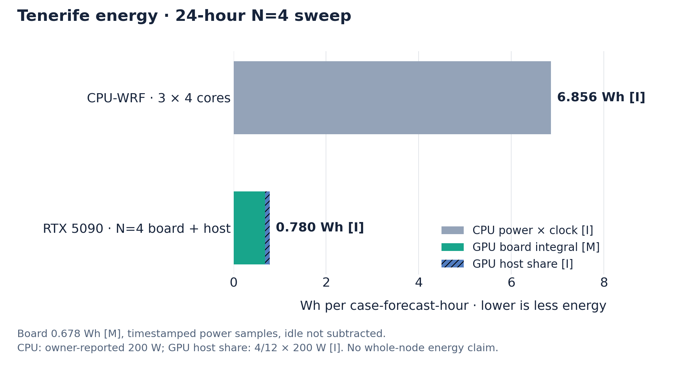
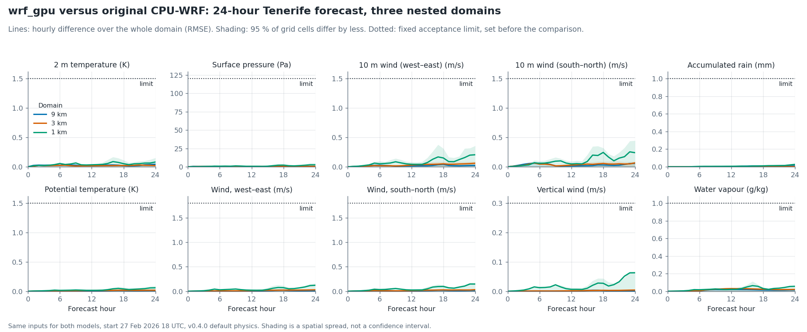

# wrf_gpu

[](release_notes/RELEASE_NOTES_v0.4.1.md)
[](LICENSE)
[](https://wrf-gpu.github.io/wrf_gpu/)
[](pyproject.toml)

**WRF-compatible regional weather forecasts on a single NVIDIA GPU, checked against the original Fortran WRF.**

`wrf_gpu` is a GPU rewrite of the WRF v4 ARW dynamical core and physics in
JAX, XLA and Pallas. It reads the inputs you already make with WPS and
`real.exe`, understands your `namelist.input`, and writes WRF NetCDF history
files that your existing tools can open. The goal is practical regional
forecasting: faster turnaround, more forecasts per workstation and less energy
per forecast hour.

On one RTX 5090, a 24-hour forecast for the Canary Islands with two nested
domains (9 and 3 km) finishes in about **100 seconds** with v0.4.1, start-up
and output included (79 seconds with v0.3.2). The main loop of the original
WRF needs **37 minutes** on 12 CPU cores.

[First forecast](#your-first-forecast-in-three-steps) ·
[User guide](https://wrf-gpu.github.io/wrf_gpu/) ·
[Supported options](docs/release/SUPPORT_MATRIX_v0.4.1.md) ·
[Validation](docs/release/VALIDATION_v0.4.0.md) ·
[Release notes](release_notes/RELEASE_NOTES_v0.4.1.md)

`wrf_gpu` is an independent project, not WRF itself, and is not affiliated
with or endorsed by UCAR/NCAR.

## Your first forecast in three steps

1. **Install** `wrf_gpu` with pip ([details](#install)), or build the
   [onboarding container](docs/onboarding.md#install-the-container), which also
   builds the original WPS and WRF tools and the GPU software for you.
2. **Run the bundled example**, a 24-hour forecast over the Swiss Alps whose
   inputs ship with the repository ([Quickstart](#quickstart)).
3. **Make a forecast for your own region.** Give a bounding box, a grid
   spacing and a start time. `gpuwrf quickstart` downloads open NOAA GFS data,
   runs WPS and `real.exe` for you and then starts the GPU forecast:

```bash
gpuwrf quickstart --profiles     # how large a grid fits on a 12-32 GB GPU
gpuwrf quickstart --bbox -17 28 -16 28.6 --resolution-km 9 \
  --date 2026-10-12T00 --hours 3 --case-dir work/tenerife --run
```

Replace the date with a recent GFS cycle. The [region guide](docs/onboarding.md)
covers the container, the geography data and each step. As a rough guide, a
12 GB card fits a grid of about 276 × 276 points and a 32 GB card about
496 × 496, with 44 levels (estimates). Region set-up is new and experimental:
its preparation steps are tested on three areas, but forecasts for new regions
have not yet been compared with CPU-WRF.

## Why wrf_gpu

- **Fast.** 21× the speed of 12-core CPU-WRF on the Canary Islands case
  (28× with v0.3.2). Three forecasts sharing one card reach 20× the
  throughput of those 12 cores.
- **Faithful to WRF.** Every release is compared field by field with the
  original Fortran WRF run from the same inputs, against limits fixed in
  advance.
- **Fits your WRF workflow.** Same inputs, same namelist, same output format.
  Fixed nests, checkpoint and restart are supported.
- **Broad physics.** More than 80 WRF physics options run on the GPU,
  including the common operational suites.
- **Many forecasts per card.** A memory-aware launcher runs ensembles and
  independent cases side by side on one GPU.

## Speed and energy

Measured on an **NVIDIA RTX 5090** with an **AMD Ryzen 9 9950X** host. GPU
times are the complete process: start-up, loading of compiled programs, the
forecast and writing every output file. The CPU-WRF reference counts only
WRF's main loop. In the charts, [M] marks measured values and [I] estimated
ones.

<picture><source media="(prefers-color-scheme: dark)" srcset="docs/release/img/v032_speed_dark.png"></picture>

Running several forecasts at once uses the card better. Four three-domain
Tenerife forecasts (9/3/1 km, 24 hours each) shared one GPU:

<picture><source media="(prefers-color-scheme: dark)" srcset="docs/release/img/v032_parallel_dark.png"></picture>

| Workload | CPU-WRF | RTX 5090 | Ratio |
|---|---:|---:|---:|
| Canary Islands 9/3 km, 24 h, one forecast | 92.3 s per forecast hour (12 cores) | **3.3 s** | **28×** |
| Tenerife 9/3/1 km, four forecasts in parallel | 123.4 s per case-hour (3 × 4 cores) | **5.5 s** | **22×** |
| Energy, same four forecasts | about 6.9 Wh per case-hour (estimate) | **0.78 Wh** | **about 9× less** |

The GPU energy is measured board power plus an estimated share of the host;
the CPU energy assumes 200 W for the 12-core run. No whole-machine power
meter was used.

<picture><source media="(prefers-color-scheme: dark)" srcset="docs/release/img/v032_energy_dark.png"></picture>

These benchmarks were measured with v0.3.2. v0.4.1 takes 4.4 s (21×), and 6.1 s
for three forecasts (20×):
[details](release_notes/RELEASE_NOTES_v0.4.1.md#speed). Other GPUs and
hosts have not been measured. Timing windows, power sampling and raw numbers
are in the [v0.3.2 measurement report](docs/release/V0.3.2.md).

<details>
<summary><b>Scaling outlook for data-centre GPUs (estimates, not measurements)</b></summary>

JAX was chosen so the model can grow to larger GPUs and many-case batches.
The two figures extrapolate the measured RTX 5090 rates to H100, B200 and
B300 cards using their memory bandwidth and capacity. They are best-case
estimates: no forecast has been run on these cards with this version.

<picture><source media="(prefers-color-scheme: dark)" srcset="docs/release/img/v032_best_case_ensemble_dark.png"></picture>

<picture><source media="(prefers-color-scheme: dark)" srcset="docs/release/img/v032_best_case_giant_domain_dark.png"></picture>

The [scaling method](docs/release/V032_BEST_CASE_SCALING.md) states every
assumption, reserve and anchor.

</details>

## What's new in v0.4.1

Released 18 October 2026. All new options are opt-in; the default
physics is that of v0.4.0 apart from the fixes listed in the release notes.

- **Data assimilation (experimental).** `gpuwrf da` combines an ensemble of
  short forecasts with radiosonde and station observations into a new starting
  state for the outer domain, and can cycle forecasts and analyses. Better
  forecasts are not yet shown.
- **Terrain winds.** `topo_wind=1/2` adds WRF's sub-grid terrain drag and
  valley wind correction for the YSU and Shin-Hong boundary layers.
- **Aerosol and clouds in radiation.** `aer_opt=1/3` feeds aerosol to RRTMG
  shortwave; `icloud=3` is WRF's scale-aware cloud fraction for radiation.
- **Tuning without recompiling.** Noah-MP surface parameters such as roughness
  and albedo can change between runs while the compiled program is reused.
- **Physics choice and ensembles.** `gpuwrf optimize` compares the released
  physics sets for your region on the GPU. SKEBS, SPPT and SPP stay within the
  comparison limits against CPU-WRF run with the same random seeds.
- **Nested runs compile once per grid.** v0.4.0 compiled the inner nests again
  for every new forecast date (about 14 minutes on a Tenerife three-domain
  case); now one compiled program serves all dates of a grid. `gpuwrf aot-key`
  shows on the CPU which compiled programs two cases share. If you share a
  compile cache across dates with v0.3.x, read the note in the
  [release notes](release_notes/RELEASE_NOTES_v0.4.1.md#note-for-users-of-v030-to-v034-nested-runs-with-a-shared-compile-cache).

The new radiation, terrain-wind and stochastic options each passed a 24-hour
comparison with CPU-WRF in the set-ups tested, so they remain experimental
elsewhere. The physics on the GPU:

| Physics | Options running on the GPU | Default |
|---|---|---|
| Microphysics | 31 schemes: Kessler, Lin, WSM3–7, WDM5–7, Thompson (also aerosol-aware and hail), Morrison, Milbrandt–Yau, NSSL, Ferrier, Goddard, P3, CAM, Jensen–ISHMAEL, NTU and more | Thompson |
| Cumulus | 15: Kain–Fritsch family, Betts–Miller–Janjić, Grell–Freitas, Grell 3D, Grell–Devenyi, Tiedtke, SAS family, Zhang–McFarlane | Kain–Fritsch (coarse domains) |
| Boundary layer | 14: YSU, MYJ, MYNN, ACM2, QNSE, BouLac, Shin–Hong, TEMF, UW and more | MYNN |
| Surface layer | 8 | MYNN |
| Land and water | Noah-MP with its main options, RUC, SSiB; lake, urban canopy and ocean mixed-layer models | Noah-MP |
| Radiation | RRTMG (with aerosol and scale-aware cloud fraction), RRTM, CAM, Goddard, Dudhia | RRTMG |

Every option in the table ran in at least one 24-hour GPU forecast compared
with CPU-WRF (Goddard radiation: six hours). Not every combination or option
inside nested domains is covered, and many non-default options are not yet
tuned for speed. The
[support matrix](docs/release/SUPPORT_MATRIX_v0.4.1.md) gives the status of
each option. Unsupported choices stop before the run with a clear reason.

## How we check it against WRF

The reference is always the original Fortran WRF, never an older version of
this project. For each test we run CPU-WRF and `wrf_gpu` from identical
inputs and compare every hourly output field over the whole grid. The
acceptance limits were fixed before the comparisons and are never loosened
afterwards: for example 1.5 K for 2 m temperature, 120 Pa for surface
pressure and 1 mm for accumulated rain (root-mean-square differences). Grid
and terrain fields must match exactly.

<picture><source media="(prefers-color-scheme: dark)" srcset="docs/release/v040_figures/readme_validation_dark.png"></picture>

In this 24-hour Tenerife forecast with three nested domains, the largest
hourly difference stays below a quarter of its limit for every field; for
2 m temperature it is at most 0.09 K.

For v0.4.0 this check passed on **66 different physics configurations**, and
the default physics passed on five real cases over the Canary Islands and the
Swiss Alps. The comparisons also found real bugs: an error in how the Tiedtke
cumulus scheme was called made the accumulated-rain difference peak at 1.1 mm;
after the fix it peaks at 0.03 mm.

From v0.4.1 on, every release is also
[checked the way operational users run it](release_notes/RELEASE_NOTES_v0.4.1.md#appendix-real-world-release-checks):
from a warm compile cache, on a new forecast date with longer input files, as
a 72-hour three-domain forecast compared with CPU-WRF, and from the release
bundle on several dates.

Results are close to WRF, not bit-identical. GPUs round floating-point
arithmetic differently, and weather is chaotic, so small differences grow
with forecast length. In our 72-hour comparisons most late differences are
about as large as those between two CPU-WRF runs started from slightly
different conditions. The [validation page](docs/release/VALIDATION_v0.4.0.md)
has every result, including the cases that exceed the limits late in long
runs.

## Install

You need an NVIDIA GPU of the Ampere generation or newer (compute capability
8.0+), a CUDA 13 driver, Python 3.11+ and a WRF v4 source or run directory for
its runtime tables. The release was tested on an RTX 5090; a three-domain
forecast like the Tenerife case used about 5 GB of GPU memory in the v0.3.2
benchmark.

```bash
git clone https://github.com/wrf-gpu/wrf_gpu.git
cd wrf_gpu
pip install "jax[cuda13]==0.10.*"
pip install -e .
export GPUWRF_WRF_ROOT=/path/to/WRF   # directory with WRF's run/ tables
```

Large microphysics lookup tables, including the Thompson tables the
quickstart needs, are downloaded on first use from the GitHub release and
checked against pinned checksums.

The [installation guide](https://wrf-gpu.github.io/wrf_gpu/installation.html)
covers optional dependencies and offline table caches.

## Quickstart

The repository ships a small 3 km case over the Swiss Alps (15 January 2023)
with Thompson, RRTMG, MYNN and Noah-MP physics:

```bash
gpuwrf doctor examples/switzerland_d01
gpuwrf run --input-dir examples/switzerland_d01 \
  --output-dir runs/switzerland --domain d01 --hours 24 \
  --scratch-dir runs/switzerland_scratch
```

The first run compiles the model for this grid and physics, which takes
several minutes; later runs reuse the compiled programs. The output in
`runs/switzerland` is ordinary WRF NetCDF history: open it with xarray,
ncview or your usual post-processing. The [example page](examples/switzerland_d01/README.md)
compares it with the original CPU-WRF run.

## Run your own case

Bring `namelist.input`, `wrfinput_d0*` and `wrfbdy_d01` from your usual WPS
and `real.exe` workflow, or let `gpuwrf quickstart` prepare them (step 3
above). For fixed nests, let the namelist decide the domains:

```bash
gpuwrf doctor /path/to/case
gpuwrf run --input-dir /path/to/case --output-dir runs/my_case \
  --domains-from-namelist --hours 24
```

Several independent cases, for example different dates or ensemble members,
can share the card. The launcher checks GPU and host memory and queues the
rest:

```bash
scripts/run_parallel_cases.sh --out-root runs/batch CASE_A CASE_B CASE_C -- \
  --domains-from-namelist --hours 24
```

Long runs can write checkpoints and resume after an interruption, for single
and nested domains. The [command guide](docs/release/USER_GUIDE_v0.4.1.md)
covers checkpoint and restart, ensembles, products, station verification and
the other tools. If you work with an AI coding assistant, point it at
[AI_OPERATOR.md](AI_OPERATOR.md).

## How it works

The WRF equations stay recognisable: third-order Runge–Kutta time stepping,
split acoustic steps, the staggered Arakawa C grid and column physics. JAX
traces the model once per grid and physics selection, XLA compiles it for the
GPU, and hand-written Pallas kernels handle the hot spots such as vertical
column solvers and microphysics.

Precision follows WRF: like the standard WRF build, the model works in single
precision, and double precision is kept only where WRF itself uses it.
This matters on consumer GPUs, where double precision runs at about 1/64 of
single-precision speed, so porting array code to a GPU is not fast by itself.
The forecast state stays on the GPU for the whole run; output is written in
the background. A [profile of where the GPU time goes](docs/release/S4_ENDPOINT_RC3.md)
shows the largest parts of a time step.

## Limitations

- One forecast runs on one GPU. Several forecasts can share a GPU; splitting
  one domain over several GPUs is [experimental](docs/MULTI_GPU.md) and not
  yet benchmarked.
- Not every WRF option or combination is supported. Moving nests, adaptive
  time steps, WRF-Chem, fire and hydrology coupling are refused with a named
  reason.
- Results match WRF closely but not bit for bit, and differences grow with
  forecast length.
- The first run of a new grid or physics selection compiles for several
  minutes and needs more host memory than later runs.
- Older GPUs (Pascal, Turing) are not supported.

[Known issues](KNOWN_ISSUES.md) lists the open items in detail.

## Release history

| Version | Highlights |
|---|---|
| v0.4.1 | Experimental data assimilation, terrain-corrected winds, shortwave aerosol, scale-aware radiation clouds, Noah-MP tuning without recompiling, regional physics choice on the GPU |
| v0.4.0 | More than 80 WRF 4.7.1 physics options, nudging, two-way nesting, stochastic physics, ensembles and forecast tools; 66 configurations checked against CPU-WRF |
| v0.3.4 | Every namelist physics option is applied or refused; single-domain restart |
| v0.3.3 | WRF-order fixes in turbulence, convection, radiation and snow; 72-hour comparisons |
| v0.3.2 | 10% faster whole runs; the benchmarks above |

Older versions and every change are in the [changelog](CHANGELOG.md) and the
[release notes](release_notes/README.md).

## Citing

If you use `wrf_gpu` in your work, please cite the software and WRF itself:

```bibtex
@software{wrf_gpu,
  title   = {wrf_gpu: a GPU rewrite of the WRF ARW model in JAX},
  author  = {{wrf_gpu contributors}},
  year    = {2026},
  version = {0.4.1},
  url     = {https://github.com/wrf-gpu/wrf_gpu}
}
```

Skamarock, W. C., and co-authors, 2019: *A Description of the Advanced
Research WRF Model Version 4.* NCAR Technical Note NCAR/TN-556+STR,
doi:10.5065/1dfh-6p97.

## Get involved

Questions, bug reports and ideas are welcome as
[GitHub issues](https://github.com/wrf-gpu/wrf_gpu/issues). Please include
your namelist, where the inputs came from, the version and the output
cadence. Independent validation on your own cases is especially valuable.
Start with [CONTRIBUTING.md](CONTRIBUTING.md); changes to the numerics need a
comparison with CPU-WRF, and speed-ups need matched timings.

## License

The project's own code is released under the [MIT License](LICENSE). Some
files keep their upstream terms: AER's RRTMG/RRTM code and data may not be
sold; NCAR MMM physics translations carry NCAR's BSD 3-Clause notice;
WRF-derived material carries the UCAR public-domain notice. See
[THIRD_PARTY_NOTICES.md](THIRD_PARTY_NOTICES.md). WRF® is a registered
trademark of UCAR.
